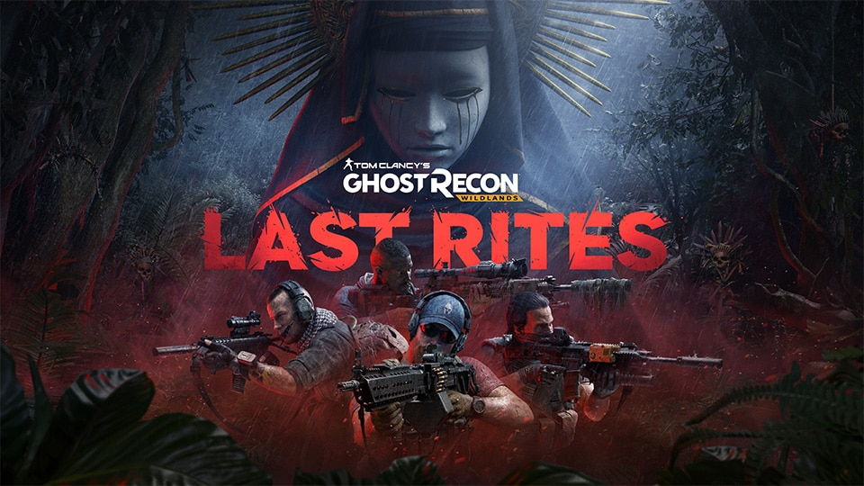

# DK RP · Painel para Ghost Recon Wildlands

<p align="center">
  
</p>

<p align="center"><strong>By: FranklinDKz (DK RP)</strong><br>Painel independente para Windows · uso em campanha solo</p>

Fiz este painel para reunir em uma janela simples as opções que estou portando para o meu jogo. A interface é em português, tem tema escuro com efeito de vidro, console de diagnóstico e duas formas de distribuição: executável portátil e instalador.

## Downloads

Baixe os arquivos na página [Releases](https://github.com/FranklinDKz/GRW-DKRP-Panel/releases/tag/v1.1.0-standalone-beta.6):

- **DKRP-GRW-Panel.exe** — versão portátil. Baixe e abra; não precisa instalar o Cheat Engine nem deixar arquivos da tabela ao lado.
- **DKRP-GRW-Panel-Setup.exe** — instalador para o perfil atual do Windows. Ele instala o painel em `%LOCALAPPDATA%\Programs\DK RP\Wildlands Panel` e cria atalhos.
- **DKRP-GRW-Panel-Portable.zip** — cópia compactada do executável portátil.
- **GRW_Atualizado_PTBR.CT** — tabela PT-BR para Cheat Engine; inclui a opção **PAINEL DK RP | Abrir painel standalone**. Essa opção abre o painel instalado e não depende da inicialização dos cheats da tabela.

O programa inclui o runtime do .NET e é destinado ao Windows x64. O Windows SmartScreen pode exibir um aviso porque os binários não têm assinatura digital de editor.

## Como usar

1. Abra Ghost Recon Wildlands e entre na campanha solo.
2. Abra o painel e confirme a caixa de uso solo/offline.
3. Clique em **INJETAR**. Se o jogo estiver aberto, o painel verifica as assinaturas antes de instalar qualquer hook. Se não estiver, escolha `GRW.exe`, abra o jogo e tente novamente.
4. Consulte **Console LOG** para ver o resultado. Se a build não corresponder ou a validação falhar, o painel recusa a ativação.

Se o log disser que já existe um hook de marcador, feche o jogo por completo e reinicie-o. Não instale a captura do painel por cima de um hook deixado por outra tabela.

O painel acessa a memória local de `GRW.exe` diretamente. Não usa nem inicia o Cheat Engine e não carrega a tabela `.CT`. A caixa solo/offline é uma confirmação do usuário; o programa não consegue determinar com certeza se a sessão está conectada a serviços online. Não use em partidas online.

A opção de painel na tabela abre `%LOCALAPPDATA%\Programs\DK RP\Wildlands Panel\DKRP-GRW-Panel.exe`; instale o painel primeiro. O arquivo `.CT` pode ser carregado separadamente no Cheat Engine.

## Estado dos recursos

Esta distribuição é experimental. O painel oferece invencibilidade, invisibilidade, proteção contra explosões, munição ilimitada, pente sem consumo, bateria ilimitada do drone, teleporte por marcador, velocidade, superpulo e NoClip. Cada assinatura é conferida antes do patch; ainda assim, isso não prova que um recurso funciona corretamente em jogo. Faça cópia dos saves antes de testar.

O teleporte agora sobe primeiro até uma altitude de trânsito, cruza em etapas e desce gradualmente sobre o marcador. Isso reduz o risco de atravessar relevo, mas não valida a colisão nem garante terreno seguro. O NoClip também é experimental. Se uma opção causar comportamento estranho, desative-a e feche o painel para restaurar os bytes monitorados.

O limite de minas, C4 e minas de proximidade ativos no mundo não foi removido. Não foi possível identificar e validar um campo ou rotina que controle esse limite nesta build; por isso, a tabela e o painel não anunciam munição explosiva ilimitada nem prometem que milhões de objetos permaneçam carregados. Tentar forçar esse número pode travar o jogo ou danificar o save.

Alcance ampliado do drone, tiro sincronizado, progressão, pontos de habilidade/suprimentos, cronômetro, proteção de veículos, aimbot, ESP, wallhack, hit kill, invocação de veículos, desbloqueios, alterações de IA, nunca procurado, salvar manualmente e pular cenas não fazem parte do painel independente.

### Assistência de mira

No controle compatível, Wildlands tem Aim Assist nativo em **Pausa → Opções → Controller → Aim Assist**. A configuração sugerida é ligada. A Ubisoft documenta a ativação pelo menu Controller; não encontrei uma opção oficial equivalente para teclado e mouse nem uma variável de configuração externa que o painel possa alternar com segurança. Por isso, o painel mostra a orientação, mas não apresenta um liga/desliga fictício. [Ajuda oficial da Ubisoft](https://www.ubisoft.com/en-gb/help/ghost-recon-wildlands/gameplay/article/accessibility-features-in-ghost-recon-wildlands/000117014).

## Compilar no Windows

Requisitos: Windows x64 e .NET SDK 10.

```powershell
.\build-release.ps1
```

O script cria o executável portátil, o ZIP com a tabela `.CT`, o instalador, a tabela individual e os hashes SHA-256 em `artifacts\1.1.0-standalone-beta.6`. O código do instalador fica em `SetupApp`.

## Diagnóstico e privacidade

O painel lê os metadados e calcula o SHA-256 local de `GRW.exe`; a Ubisoft não fornece um hash oficial para comparar. Portanto, o painel não declara que uma instalação é a versão mais recente só pelo nome ou hash do executável. O caminho e o hash aparecem na tela de diagnóstico. Os logs são mantidos na janela enquanto ela estiver aberta.

O aviso de sincronização dos contatos online é exibido pelo jogo ou Ubisoft Connect. O painel não controla essa conexão e não consegue corrigir nem ocultar a mensagem.

## Contribuir

O QR Pix e a chave `dkpixscr@gmail.com` foram fornecidos por mim. A contribuição é opcional. A imagem do jogo pertence à Ubisoft e está incluída apenas como referência visual; veja [ASSETS.md](ASSETS.md).

## Licença

O código-fonte deste projeto é distribuído sob GPL-3.0. A licença não cobre o jogo, marcas ou imagens da Ubisoft, nem o QR Pix. A biblioteca Iced usada para decodificar e realocar instruções x64 é distribuída sob MIT.

